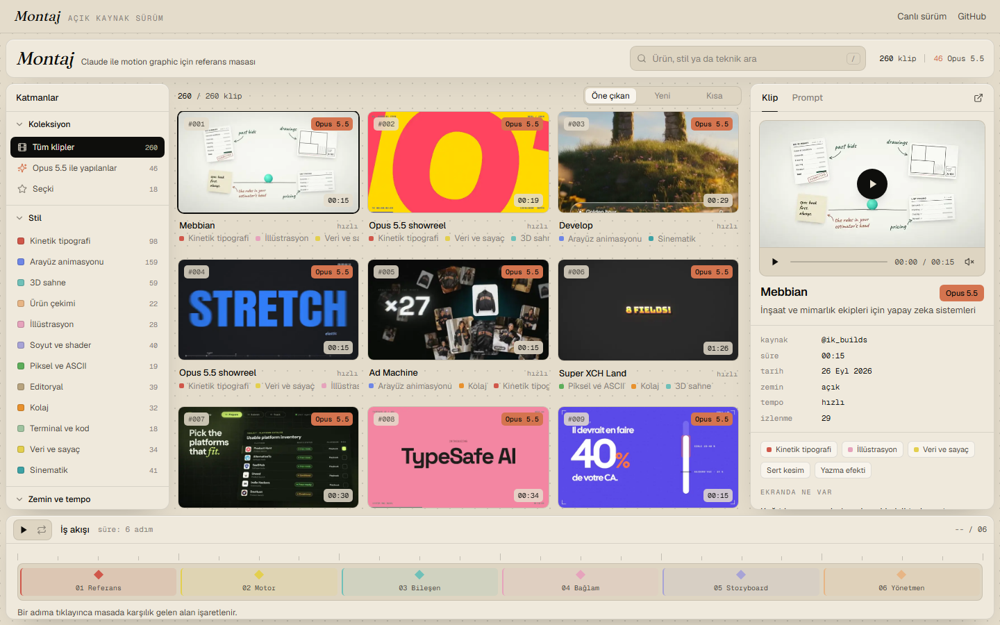

# Montaj

Claude ile motion graphic yapanlar için Türkçe referans masası. 260 lansman videosunu stile, tempoya ve tekniğe göre süzersin, bir ya da iki referans seçersin. Masa HyperFrames ya da Remotion için hazır Türkçe prompt'u kurar.

Canlı sürüm: [muhammedsevimli.com/montaj](https://himantopushimantopusconcentration4160.github.io)



## İçinde ne var

- **Masa:** katman paneli (koleksiyon, stil, zemin ve tempo filtreleri), klip ızgarası, oynatıcı ve inceleyici.
- **Prompt kurucu:** seçtiğin referanslardan ve ayarlardan (motor, format, süre, tempo, marka) Claude'a verilecek Türkçe prompt'u yazar. Kod `lib/montaj/prompt.ts` içinde.
- **Altı adımlık akış ve rehber:** altı sahne, kamera sözlüğü ve SSS. Metinler `lib/montaj/rehber.ts` içinde.
- **Veri:** 260 kaydın bağlantısı, etiketi ve Türkçe notu `lib/montaj/data/klipler.json` içinde.

## Kurulum

En kolay yol:

1. Repoyu indir. GitHub'da **Code → Download ZIP** ya da terminalde `npx degit muhammedsevimli/montaj montaj`.
2. Klasörü Claude Code'da aç ve `kur` yaz. Claude bağımlılıkları kurar ve masayı tarayıcıda açar.

Elle kurmak istersen:

```bash
bun install
bun run dev
```

npm ile de çalışır (`npm install`, sonra `npm run dev`). Masa `http://localhost:3000` adresinde açılır.

## Medya nerede

Videolar ve önizlemeler başka creator'ların içeriği, bu yüzden repoda yok. Masa onları muhammedsevimli.com'dan akıtır, o yüzden internet bağlantısı gerekir.

Medyayı kendi sunucunda tutmak istersen `.env.example` dosyasını `.env.local` adıyla kopyala ve `NEXT_PUBLIC_MONTAJ_MEDYA` adresini değiştir. Her kayıt için üç dosya beklenir:

| Dosya | İçerik |
|---|---|
| `<id>.mp4` | tam video |
| `<id>-p.mp4` | 8 saniyelik önizleme |
| `<id>.webp` | afiş karesi |

## Klip eklemek

`lib/montaj/data/klipler.json` dosyasına bir kayıt ekle. Alanların anlamı `lib/montaj/types.ts` içinde yazıyor. Kaydın medyasını yukarıdaki adlarla kendi medya adresine koy.

## Kaynaklar ve krediler

- Kataloğun 214 kaydı [whatships.com](https://himantopushimantopusconcentration4160.github.io) kataloğundan ([dingyi/whatships.com](https://himantopushimantopusconcentration4160.github.io), MIT) süzülüp Türkçeye uyarlandı. Stil, tempo ve teknik etiketleri kareler incelenerek verildi.
- 46 Opus 5.5 örneği 25 ve 26 Eylül 2026'da X'te tarandı.
- Altı adımlık akış [Rexan Wong'un notundan](https://himantopushimantopusconcentration4160.github.io) uyarlandı.
- Panel, kaydırıcı ve keyframe dili [Toolcraft](https://himantopushimantopusconcentration4160.github.io)'tan (MIT) uyarlandı.
- Lisans metinleri [THIRD_PARTY_NOTICES.md](THIRD_PARTY_NOTICES.md) dosyasında.

## Kaldırma talebi

Videolar ve markalar sahiplerine ait, her kayıt orijinal X gönderisine bağlanır. Montaj bu ürünlerin hiçbiriyle bağlantılı değil. Kaydının çıkarılmasını istiyorsan X'te [@_msevimli](https://himantopushimantopusconcentration4160.github.io) hesabına yaz ya da issue aç. Kayıt 72 saat içinde hem sitede hem bu repoda çıkarılır.

## Lisans

Kod MIT lisanslı ([LICENSE](LICENSE)). Katalogdaki whatships kaynaklı kayıtlar kendi MIT lisanslarıyla gelir.

Geliştirmek isteyen PR gönderebilir. Takıldığın yeri issue olarak yazarsan bakarım.

---

**Muhammed Sevimli** · [YouTube](https://himantopushimantopusconcentration4160.github.io) · [X](https://himantopushimantopusconcentration4160.github.io) · [Instagram](https://himantopushimantopusconcentration4160.github.io) · [Threads](https://himantopushimantopusconcentration4160.github.io) · hey@muhammedsevimli.com

Claude ile gerçek sistemler kuruyorum ve kurarken gösteriyorum. Adım adım rehber ve destek için: [Atölye](https://himantopushimantopusconcentration4160.github.io)
